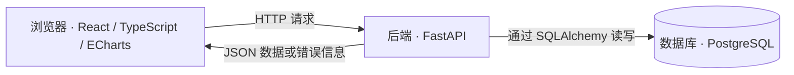

# EconoMind MVP 架构

## 目标与范围

MVP 跑通注册登录、CSV 上传与存储、经济指标查询和计算、图表展示，并提供基础管理页面查看导入记录。Excel 导入、公开数据自动采集、AI 问答、预测和报告属于后续阶段。

## 本地数据中心

登录后的数据中心读取随前端打包的官方季度核算快照和两套教学 CSV。三个官方专题共用一份含发布日期和原表链接的 JSON 快照。`frontend/src/catalog.ts` 维护双语说明、统计口径和官方发布链接。预览按季度范围筛选观测值，下载和一键导入共用同一段 CSV。导入复用登录账号的上传接口，工作台按返回的数据集编号从 PostgreSQL 重新查询，对齐同一季度的两个指标，以该数据集当季 GDP 为分母计算占比。缺失金额或无效分母显示为缺值。

网上零售专题单独保存季末发布表的实物网零额、社零总额和正文公布的累计占比。先对完整快照按自然年差分，再筛选和导入。CSV 代码区分累计与当季、金额与百分比。工作台按相同口径查询三条序列，推算期可回看本期和上期发布表。

## 整体设计

采用前后端分离、单体后端和一个 PostgreSQL 数据库。单体后端指登录、导入、查询和分析在同一个 FastAPI 应用中运行，代码按职责划分模块。前端通过 HTTP API 请求数据，后端通过 SQLAlchemy 访问数据库。

| 层 | 职责 |
| --- | --- |
| 前端 `frontend/` | 用 React 构建注册登录、上传、指标筛选和基础管理页面，用 TypeScript 描述接口数据，用 ECharts 绘制时间序列。 |
| 后端 `backend/` | 用 FastAPI 提供 API，处理登录和权限检查、文件校验、指标查询及同比和环比计算。用 Pydantic 校验结构化请求和响应，用 SQLAlchemy 访问数据库。 |
| PostgreSQL | 保存用户、数据集、指标和观测值。数据集记录来源和上传者，指标记录单位和频率，观测值记录某个统计期的数值。数据库约束防止同一数据集内同一指标同一期重复录入。 |

## 数据流转

以导入季度 GDP 并查看同比为例。

1. **上传**。用户登录后选择 CSV。浏览器将文件发送到 FastAPI，后端检查上传权限和文件大小。
2. **校验与保存**。后端检查必填列、统计期、数值和重复记录。校验失败时返回可定位的行号和原因，用户可修正后重试。校验通过后，用一次数据库事务写入整批数据。写入失败时整批回滚。
3. **查询与计算**。用户选择指标和时间范围，后端查询该范围及计算所需的基期数据。季度同比以上年同季度为基期，环比以上一季度为基期。基期缺失或为零时，对应增速返回空值。
4. **展示**。后端以 JSON 返回时间序列、单位、数据来源和计算结果，前端用 ECharts 绘图并展示数据口径。

## 技术取舍

| 决策 | 选择与理由 |
| --- | --- |
| 后端组织 | 采用按模块组织的 FastAPI 单体，本地只需运行和调试一个后端。多个服务可以独立部署，但会增加服务间通信和运行配置。 |
| 数据库 | 在数据库阶段引入 PostgreSQL，让本地和部署环境使用同一种数据库。SQLite 的启动成本更低，PostgreSQL 需要额外配置。 |
| 数据导入 | 首版采用有文件大小上限的同步 CSV 导入，用户可直接收到结果。后台任务适合耗时导入，同时需要维护任务状态和重试。 |

## 第三阶段数据实现

- `users` 预留用户编号和唯一邮箱，供后续注册和登录使用。数据集通过可空的 `uploaded_by` 关联用户，当前命令行导入可以留空。
- `datasets` 保存每批导入的来源，`indicators` 保存指标代码、名称、单位和频率。
- `observations` 以数据集、指标和季度组成主键。数值使用 PostgreSQL `NUMERIC(18,6)`，在 Python 中用 `Decimal` 计算。
- 当前由命令行发起 CSV 导入，校验通过后在一次事务中写入数据集和观测值。查询 API 会读取起始季度前最多四个季度计算基期，只返回请求区间内的观测值。

## 第五阶段 MVP 闭环

- 账号密码使用 Argon2id 哈希。浏览器通过 HttpOnly、SameSite 会话 Cookie 传递随机令牌，PostgreSQL 保存令牌的哈希和过期时间。退出登录会撤销会话。
- 网页上传和导入记录需要登录。数据集记录上传者，查询依据当前会话限制可见范围。命令行导入留空上传者，作为可通过 API 查询的共享数据。
- 网页和命令行复用 CSV 大小、编码、行校验及事务逻辑。API 将有效导入连到已有的指标计算和图表。管理界面展示可访问的导入记录及观测值数量。
- `backend.data_cli init` 可重复执行，负责在已有数据库上添加账号字段和会话表。

## 第六阶段 AI 研究助手

- 后端复用已授权的指标查询和同比、环比计算，只检索所选数据集、指标和季度。模型只可调用读取本次证据的工具，工具参数无法扩展查询范围。
- DeepSeek Responses API 第一轮请求工具调用，第二轮提交观测值并要求结构化答案。后端验证引用编号是否来自实际检索，再把本地数据集、来源、指标、日期和单位交给前端。
- 空数据由后端直接识别。模型可返回证据不足。此阶段使用 PostgreSQL 做结构化检索增强，资料文档与向量索引留待有文档检索需求时引入。

## 第七阶段季度模型比较

- 预测接口复用现有数据集访问规则，按当前筛选范围读取观测值，再调用与 CSV 命令相同的回测逻辑。
- 每个目标季度仅使用此前连续四期。基线取最近一期，趋势模型用普通最小二乘拟合直线。两种模型在同一组目标上计算 MAE 和 RMSE。
- 界面展示逐期实际值和预测、误差摘要及趋势图。当最近四期连续时，显示最后观测季度之后一季度的估计，并将它排除在回测误差之外。
