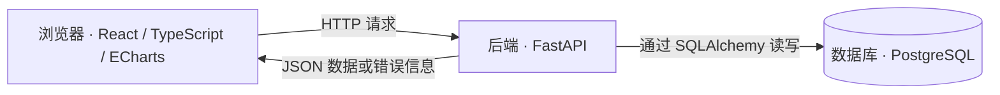

# EconoMind MVP 架构

## 目标与范围

MVP 跑通注册登录、CSV 上传与存储、经济指标查询和计算、图表展示，并提供基础管理页面查看导入记录。Excel 导入、公开数据自动采集、AI 问答、预测和报告属于后续阶段。

## 整体设计

采用前后端分离、单体后端和一个 PostgreSQL 数据库。单体后端指登录、导入、查询和分析在同一个 FastAPI 应用中运行，代码按职责划分模块。前端通过 HTTP API 请求数据，后端通过 SQLAlchemy 访问数据库。

| 层 | 职责 |
| --- | --- |
| 前端 `frontend/` | 用 React 构建注册登录、上传、指标筛选和基础管理页面，用 TypeScript 描述接口数据，用 ECharts 绘制时间序列。 |
| 后端 `backend/` | 用 FastAPI 提供 API，处理登录和权限检查、文件校验、指标查询及同比和环比计算。用 Pydantic 校验结构化请求和响应，用 SQLAlchemy 访问数据库。 |
| PostgreSQL | 保存用户、数据集、指标和观测值。数据集记录来源和上传者，指标记录单位和频率，观测值记录某个统计期的数值。数据库约束防止同一数据集内同一指标同一期重复录入。 |

## 数据流转

以导入季度 GDP 并查看同比为例。

1. **上传**。用户登录后选择 CSV。浏览器将文件发送到 FastAPI，后端检查上传权限和文件大小。
2. **校验与保存**。后端检查必填列、统计期、数值和重复记录。校验失败时返回可定位的行号和原因，用户可修正后重试。校验通过后，用一次数据库事务写入整批数据。写入失败时整批回滚。
3. **查询与计算**。用户选择指标和时间范围，后端查询该范围及计算所需的基期数据。季度同比以上年同季度为基期，环比以上一季度为基期。基期缺失或为零时，对应增速返回空值。
4. **展示**。后端以 JSON 返回时间序列、单位、数据来源和计算结果，前端用 ECharts 绘图并展示数据口径。

## 技术取舍

| 决策 | 选择与理由 |
| --- | --- |
| 后端组织 | 采用按模块组织的 FastAPI 单体，本地只需运行和调试一个后端。多个服务可以独立部署，但会增加服务间通信和运行配置。 |
| 数据库 | 在数据库阶段引入 PostgreSQL，让本地和部署环境使用同一种数据库。SQLite 的启动成本更低，PostgreSQL 需要额外配置。 |
| 数据导入 | 首版采用有文件大小上限的同步 CSV 导入，用户可直接收到结果。后台任务适合耗时导入，同时需要维护任务状态和重试。 |
